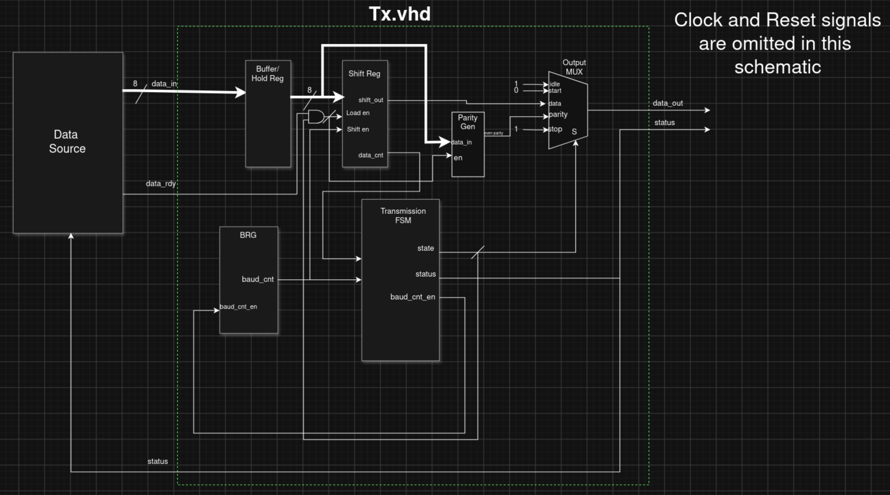

# Hermes
 Hermes is a simple UART protocol implementation in VHDL. 

## Definitions
To make certain things easier to explain and keep terminology uniform I have prepared a list of not self explanatory words used in this documentation.

| Word/Phrase | Definition |
| --- | --- |
| BRG | Baud Rate Generator, the module that sends the enable pulses for the receiver and transmitter | 
| OSR | Oversampling Rate, for Rx this is fixed at 16 |
| bitmid(short: `mid`) | 1/2 bittime |
| tick | Frequency/(OSR*Baudrate), i.e 1/OSR of a bittime(in clock cycles) |

### Not implemented yet

### Known Issues

## Hardware and Toolchain

| Component | Version |
| --- | --- |
| Board | DE10-Lite |
| FPGA | MAX 10 10M50DAF484C7G |
| Synthesis | Altera Quartus |
| Simulation | Altera Questa |
| Testframework | VUnit |

If you wish to run tests, do not do it via quartus, as the testbenches have not been included in the quartus project to avoid compatibility issues. Refer to the [Testing and Verification](https://github.com/Gamydas/Hermes-UART-/blob/main/README.md#testing-and-verification) Section

## How to Use

## Timing Behavior

- The BRG generates an enable signal for the transmitter for one cycle at the end of a bittime
- The BRG generates an enable signal for the receiver for one cycle at `mid-1`, `mid` and `mid+1`

## Timing Data 

## Architecture Transmitter (Tx)
The UART Transmitter(`Tx.vhd`) transmits data as defined by the UART protocol in the form of 8E1, meaning 8 bits of data, Even parity and one stop bit. Both parity and length of the stop bit might become generically configurable in the future.

### Interface/Port Map

| Generic | Purpose | 
| --- | --- |
| freq | used to configure the UART to the devices frequency,**default is 50 MHz** | 
| baud | used to set a before agreed upon baud rate, **default is 115200** |

| Ports | Direction | Purpose |
| --- | --- | --- |
| clk | IN | system clock port |
| rst | IN | global async reset port |
| data_rdy | IN | port for the source of the data to tell the transmitter that data has been put on on the data_in port. This data takes on cycle to be written into the buffer/holding register of the transmitter, so wait atleast 1 cycle between putting data on the bus and setting data_rdy high |
| data_in | IN | 8 bit bus line from which the transmission data is read. Data on the bus gets loaded into the holding register at the first legal clock cycle |
| data_out | OUT | The serial output of the transmitter | 
| status | OUT | status signal of the transmitter, used to signal the beginning of a transmission/successful acceptance of bus data |

### Functionality
The transmitter is driven by a `5 State FSM`, containing the states `idle`, `start`, `data`, `parity` and `stop`. Below is a table explaining the different states.

| State | Purpose |
| --- | --- |
| `idle` | Transmitters idling phase. During this time, the `data_out` Port is constantly held high. This phase also actively stop/resets the BRG |
| `start` | Transmissions start bit. As is usual in UART, the `data_out` is pulled low **for exactly 1 bittime** before beginning data transmission. All changes to input data happening will no longer be considered for this transmission |
| `data` | Transmission of data. 1 Bit gets shifted out of the `tx_shift_reg` per **bittime** not per clock cycle, at 50 MHz/115200 baudrate this would be 434 clock cycles | 
| `parity` | Transmission of parity. For now the Transmitter **always** sends an even parity bit | 
| `stop` | Transmission of stop bit. As is usual in UART, the `data_out` is pulled high **for exactly 1 bittime**(this might become configurable) before either entering `start` or `idle` again |

Apart from the FSM the transmitter is also fitted with 2 registers and of course the `BRG`/`baud enable generator`. \
First is `tx_hold_reg`, which is the buffer/holding register, loading data from the bus before and during transmissions. \
The other is the `tx_shift_reg`, this is the serial out shift register of the transmitter, used to push the parallely loaded data bits onto the `data_out` line.

Lastly the `BRG`, at compilation the `bittime` constant is calculated, which follows from the formula **frequency/baud** which gives us the bittime in cycles instead of seconds. The counter counts up to bittime-1 before wrapping back to 0.
The counter wraps at bittime-1 instead of bittime because this allows the FSM to drive transmission on the final rising edge of the bittime, removing the 1 cycle latency mentioned in [Decisions](https://github.com/Gamydas/Hermes-UART-/blob/main/README.md#removing-the-brg-module). 

To begin transmission the data on the bus(`data_in`) must first be loaded into the holding register(1 cycle) and then `data_rdy` has to be set high for atleast 1 more clock cycle. This starts the transition between `idle` and `start` state. 

For continuous data transmission the transmitter outputs a status signal. This signal goes high for exactly 1 bittime when the start state is entered, before going back to low. The source of data can use this in many ways, as data in the 
shift register can not be changed anymore once the `start` state has been entered. This means that the source can reliably send new data on the rising edge of this signal, on the continous high level or on the falling edge. All 3 guarantee 
that the new data will be asserted, **IF** the `data_rdy` signal is high when the `stop` state of is exited. 

Realistically continuous transmission could look like this: 
**[IMAGE FOLLOWS]**

### Block Schematic

## Architecture Receiver (Rx)

### Interface/Port Map

| Generic | Purpose | 
| --- | --- |
| freq | used to configure the UART to the devices frequency,**default is 50 MHz** | 
| baud | used to set a before agreed upon baud rate, **default is 115200** |

| Ports | Direction | Purpose |
| --- | --- | --- |
| clk | IN | system clock port |
| rst | IN | global async reset port |
| Rx  | IN | Receivers connection to the dataline, this is where serial data gets read |
| data_out | OUT | 8 bit wide signal connected to an internal register storing the received byte | 
| parity_err | OUT | status flag to signal that the received frame has a parity error |
| frame_err | OUT | status flag to signal that the received frame has a framing error caused by a faulty stop bit | 

### Functionality

The receiver is driven by a `5 State FSM`, containing the states `idle`, `start`, `data`, `parity` and `stop`. Below is a table explaining the different states.
 
| State | Purpose |
| --- | --- |
| `idle` | Receivers idling phase. During this time, the BRG is being stopped/reset |
| `start` | Receivers start bit. This state is triggered when the dataline is pulled low('0') |
| `data` | Reception of data. 1 Bit gets sampled around the `mid` and then shifted into the `rx_shift_reg` | 
| `parity` | Reception of parity. If parity does not match the `parity_err` flag will be set **in the stop state** | 
| `stop` | Reception of stop bit. If stop bit does not match the `frame_err` flag will be set. The faulty frame will still be written into the output buffer and displayed alongside the status flags |

The receivers FSM is used as a general driver of the system. It drives the enable signal for the shift register, it drives the synchronous reset
of the sampling process and it drives the output of the receiver. \

Besides the FSM the receiver also consists of a SiPo shift register to serially read in data, a BRG, a holding register/buffer at the output to store
the received frames data and a 3 bit shift registers to sample the incoming data around the `mid`. \

Once the start bit goes low the Receiver will start recording the incoming frame and store it in the output buffer regardless 
of wether it is a correct frame or not (as signaled by the status flags). The overlying owner of the module needs to decide
what to do with faulty packages. \

The `sample_bit` process containing the 3 bit shift register samples the dataline 3 times per bittime on `mid-1`, `mid` and `mbp+1`. 
The actual evaluation happens concurrently in the `val` signal via a majority decision(best of 3). On `mid + 2` we have a guaranteed actionable sample. The sampled and 
evaluated bit gets sent into a demultiplexer which is driven by the FSM. This decides into which register its stored, `start_val`, `data_in`,
`parity_val` or `stop_val`. `start_val` is used at the end of the first bittime to see wether the receiver goes into data reception mode or back to idling.
These others are used for at `mbp + 3` to either drive the shift register or set the status flags.

### Timing and Tolerance

#### Constants

The receiver derives 3 constants from `freq` and `baud`:
| Constant | Formula | Meaning |
| --- | --- | --- |
| `baud_tick` | `freq / (16 * baud)` | Length of one tick in clock cycles |
| `tick_amt` | `(freq / baud) / baud_tick` | Number of ticks per bittime |
| `bit_mid` | `tick_amt / 2` | Tick index of `mid` |

The end of a bittime is derived from `tick_amt`*`baud_tick`, not from `16*baud_tick` as division floors, which would cause
an accumulation of errors. Any `baud_ticks` that would be more than 0.5 over the next lower integer would cause failure of reception.

#### Synchronisation

The BRG starts on the first rising edge after the dataline `Rx` is seen low('0'). After the stop bit is received and the frame data is written
to the output buffer the FSM transitions to `idle` so to reset the BRG and make sure drift only accumulates over a single frame, not the entire
data stream.

#### Intrinsic bittime error

As stated before, the divison floors causing shorter than actual bittimes.

| freq | baud | `baud_tick`(floor) | `baud_tick`(actual)| `tick_amt`(floor) | actual | bittime(floor) | bittime(actual) | Intrinsic error |
| --- | --- | --- | --- | --- | --- | --- | --- | --- |
| 1.8432 MHz | 9600   | 12 | 12.00 | 16 | 16.00 | 192 | 192.00 | 0.00 % |
| 1.8432 MHz | 115200 | 1  | 1.00  | 16 | 16.00 | 16  | 16.00  | 0.00 % |
| 12 MHz     | 115200 | 6  | 6.51  | 17 | 17.36 | 102 | 104.17 | −2.08 % |
| 20 MHz     | 115200 | 10 | 10.85 | 17 | 17.36 | 170 | 173.61 | −2.08 % |
| 50 MHz     | 9600   | 325| 325,52| 16 | 16.025| 5200| 5208.33| −0.16 % |
| 50 MHz     | 115200 | 27 | 27.12 | 16 | 16.075| 432 | 434.03 | −0.47 % |

#### Measured Tolerance

| freq | baud | Passing range | Lower limit | Upper limit |
| --- | --- | --- | --- | --- |
| 1.8432 MHz | 9600 | −4 % … +5 % | between −5 % and −4 % | between +5 % and +6 % |
| 1.8432 MHz | 115200 | −4 % … +5 % | between −5 % and −4 % | between +5 % and +6 % |
| 12 MHz | 115200 | −6 % … +3 % | below −6 %, not bracketed | between +3 % and +4 % |
| 20 MHz | 115200 | −6 % … +3 % | below −6 %, not bracketed | between +3 % and +4 % |
| 50 MHz | 9600 | −4 % … +5 % | between −5 % and −4 % | between +5 % and +6 % |
| 50 MHz | 115200 | −4 % … +5 % | between −5 % and −4 % | between +5 % and +6 % |

As we can see, configurations without a severe intrinsic error are roughly symmetrical around 0 with a range of roughly +-5%.
Configurations with a noticable intrinsic error (in this case the 12 MHz and the 20 MHz config) cause the window to be shifted down
by the amount of the error. The theoretical limit of UART error tolerance lies at ~5%, but this is not a safe marin.

#### Guaranteed Tolerance

Every configuration passes within the window of **+-3%**. While some configurations can work outside of this aswell, this is the only
guarantee we can derive from tests and is considered the safe margin of error to maintain in a UART transmission.  

## Modules

## Decisions 

### Removing the BRG module  
Previously this was a separate module, however this caused timing issues, causing a 1 clock cycle delay between the end of the bittime and the actual transmission of data, while this wouldn't have broken the design, I preferred to change it to a single process within the `Tx` module and later the `Rx` module.

### Implementing an OSR
I've decided to implement oversampling to allow the receiver to make a best of 3 decision for enhanced safety against glitches.

## Testing and Verification
As mentioned in the beginning, this project was tested via the VUnit [test framework](https://vunit.github.io/user_guide.html).
Look up the installation guide for VUnit before continuing.

### How to use
In the projects root directory there is a `run.py` file. With this we control the entire test environment.
- The command `python run.py` starts every test in every testbench, depending on the amount of tests there are, this could take a while.
- To start a specific test or testbench we instead run `python run.py *[name of testbench].[name of test]`. `[name of test]` can be substituted with an asterisk to start every test in the testbench.
- To specify a configuration type `python run.py *[name of testbench].[configuration].[name of test]` into your  terminal

### Currently implemented tests and configurations

#### TX_tb

This is a list of all configurations that are implemented for the transmitter testbench. This list is significantly shorter than the one of the receiver due to entirely different timing constraints. 
| Configuration | Frequency | Baud| 
| --- | --- | --- |
| `two_cycles` | 2*115200 Hz | 115200 |
| `four_cycles` | 4*115200 Hz | 115200 |
| `real_board` | 50 MHz | 115200 |

These tests have been implemented for the transmitter module.
| Name | What it proves |
| --- | --- |
| `idle_test` | The signal is high('1') after a reset and stays this way |  
| `send_byte_test` | A single byte is being sent as an 8E1-frame : startbit, eight databits with LSB first, even-parity , stopbit, sampling happens after 1/2 of a bittime |
| `send_multiple_bytes` | Two frames run seamlessly back to back. The second startbit follows directly after the first stopbit without any idletime inbetween. Both parities are being covered in this test |
| `change_data_during_transmission` | New data is being put on `data_in` during the frame(after databit 3) and `data_rdy` is being set high('1'). Neither changes the currently sent package. |
| `reset_during_transmission` | `rst` during a frame cancels transmission and sets the dataline igh '1' to signal idling. This state is maintained for 100 cycles before pulling reset back low('0') sending a new frame. The new frame arrives fully intact |
| `idle_between_transmissions` | A frame is being sent over the dataline before entering the idle state for a specified(100 bittimes in this case) before sending the next frame. Both arrive fully intact |

#### RX_tb
As the receiver turned out to be a greater challenge than the transmitter, there are more configurations and testcases for this module.

The configuration list was made based on my findings only of what the most common UART configurations are.
| Configuration | Frequency | Baud| 
| --- | --- | --- |
| `1.8432MHz_9600B` | 1.8432 MHz | 9600 |
| `1.8432MHz_115200B` | 1.8432 MHz | 115200 |
| `12MHz_115200B` | 12 MHz | 115200 |
| `20MHz_115200B`| 20 MHz| 115200 |
| `50MHz_9600B` | 50 MHz | 9600 |
| `50MHz_115200B` | 50 MHz | 115200 |

This list represents all the functional tests of the receiver.
| Test case | What it proves |
| --- | --- |
| `idle_test` | Dataline is held high. No false receptions |
| `receive_one_byte` | A single byte is being received as 8E1-frame in the correct timeframe |
| `receive_multiple_bytes` | Seamless reception of multiple bytes |
| `receive_with_idle_gaps` | Receiving bytes with differing idle periods inbetween. Idling between reception does not corrupt or damage packages and does not impact Rx functionality |
| `error_tests` | Forcefully transmit wrong parity and stop bits to test that status flag outputs of the receiver correctly work |
| `error_then_valid_test` | Forcefully transmit a faulty frame and then send a correct one. The correct frame overwrites the faulty one in the buffer and resets status flags |
| `reset_during_receive` | Reset is set high('1') during reception. Reception stops and no half finished packages remain in any buffer |
| `loopback` | Tx output is put on the dataline. Tx and Rx can succesfully communicate with one another |

This list represents all timing specific test of the receiver. For these tests the testbench was refitted to no longer use clock
cycles to wait out time but instead wait bittimes in (micro)seconds as definied by the C_BIT_TIME constant. This had to be done 
because waiting for clock cycles was to rigid and unprecise for these tests.
| Test case | Transmitter deviation |
| --- | --- |
| `-6%_timing_test` to `-1%_timing_test` | −6 % to −1 % in 1 % steps |
| `+1%_timing_test` to `+6%_timing_test` | +1 % to +6 % in 1 % steps |

### Deprecated Modules
Space where deprecated contents can still be found. Unsure if this will be deleted at some point.

### Baud Rate Generator
The Baud Rate Generator(`BRG.vhd`) generates one cycle pulses for both tx and rx logic, i.e. telling both the transmitter when to send and the receiver when to read. For the Rx side, the BRG sends 3 pulses centered around
the mid-bit-point to decide out of a best of 3 when reading differing signals during this window. I.e Rx reads '1' at mbp-1, '0' at mbp and '1' on mbp + 1, Rx will assume that 1 is the correct value.

| Generic | Purpose | 
| --- | --- |
| freq | used to configure the UART to the devices frequency,**default is 50 MHz** | 
| baud | used to set a before agreed upon baud rate, **default is 115200** |
| OSR  | used to set an oversampling rate, necessary for the receiver to make a best of 3 decision, **default is 16, but minimum is 4** |

| Ports | Direction | Purpose |
| --- | --- | --- |
| clk | IN | system clock port |
| rst | IN | global async reset port |
| sync | IN | sync reset, used to synchronise the receiver to the transmitters start-bit when receiving packages |
| tx_enable | OUT | enable signal for the transmitter |
| rx_enable | OUT | enable signal for the receiver | 

#### BRG_tb

| Test case | What it proves |
| --- | --- |
| tx_rx_test | proves tx_enable sends a one clock cycle long pulse after a full bittime and x_enable sends a pulse after 1/2 -1 bittime and after the next 2 ticks, centered around the half of a bittime |
| tx_rx_over_10_bittimes | proves that tx_enable and rx_enable behavior does not change/drift apart over time |
| sync_test | tests if sync signal works as intended and resets the counter |
| sync_before_tx_pulse | tests if sync works as intended at a different testing point, right before tx_enable should go high |
| reset_test | essentially tests the same thing as sync_test, but asynchronously, also holds the rst high for 1000 cycles to check that the counter is stopped |
